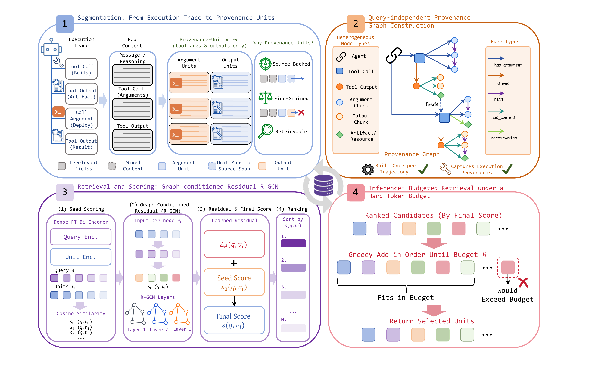

# EPGM: When Does Execution Provenance Help Agent Memory Retrieval?

Code and configurations for the paper **"When Does Execution Provenance Help Agent Memory Retrieval?"**
(WSDM 2027, Findings). The study asks a narrow question: once an agent's execution trace is already
indexed and retrievable by a semantic scorer, does propagating over the *execution relationships*
between the events — what produced what, what was read by what — recover more of the evidence the
query needs?



**(1) Segmentation.** Each execution trace is split into provenance units: every tool-argument and
tool-output field is chunked on its own, messages and reasoning are dropped, and every unit maps back
to exact source spans. **(2) Graph construction.** A provenance graph over agents, tool calls, outputs,
chunks, and artifacts is built once per trajectory, without looking at any query, using typed edges
(`has_argument`, `returns`, `next`, `has_content`, `reads/writes`, and string-matched `feeds`).
**(3) Scoring.** A fine-tuned Dense bi-encoder gives each unit a seed score; a zero-initialized R-GCN
over the typed graph adds a learned residual, so training starts exactly at the seed ranking.
**(4) Budgeted inference.** Units are added greedily in final-score order until the token budget `B`
is full.

The contribution is a controlled attribution, not a new model: the repository reproduces the
separation between **which fields are indexed**, **how those fields are grouped into candidates**, and
**whether graph propagation adds anything** on top of a fixed candidate set and a fixed seed ranking.

## Metrics

Every query carries gold evidence as a set of exact character spans in the original trace, so all
retrieval methods are scored on the same source coordinates.

| Metric | Definition |
|---|---|
| **Full Support@B** (FS@B) | Primary. 1 if every gold span is present in the retrieved set, which must fit in `B` evidence tokens; otherwise 0. |
| **Coverage@B** (Cov@B) | Fraction of gold spans recovered under the same `B`-token budget. |
| **SpanCov@k** | Fraction of gold spans recovered at a fixed number of candidates `k`, ignoring token cost (the budget-free diagnostic). |
| **FO-MRR** | First-overlap reciprocal rank: 1 / rank of the first retrieved candidate that overlaps gold. |
| **Budget-AUC** | Area under the FS or Coverage curve over budgets 256–8192 tokens. |

Full Support is deliberately conservative: it requires the annotated spans, not merely an answer, and
it does not credit substitute evidence elsewhere in the trace.

## Setup

Requires Linux and Python 3.12 (managed by `uv`). A CUDA-capable GPU is needed for the trainable
methods; deterministic methods run on CPU.

```bash
uv sync
```

ISETrace inputs come from [valiere/ISETrace](https://huggingface.co/datasets/valiere/ISETrace) (eight
trajectory shards) and [HazeLocus/ISETrace-Memory-Queries](https://huggingface.co/datasets/HazeLocus/ISETrace-Memory-Queries)
(the frozen queries and authoring metadata). The first run downloads both into
`data/isetrace/raw/trajectories/` and `data/isetrace/query-authoring/`, together with the local
encoder models under `models/`.

If `huggingface.co` is unreachable from your network, point the downloads at a mirror:

```bash
export HF_ENDPOINT=https://hf-mirror.com
```

## Reproduce

Start with a one-query-per-split lifecycle check. It downloads the inputs, builds the provenance
graph, and runs BM25 end to end:

```bash
uv run python experiment/run.py \
  name=isetrace_bm25_smoke dataset=isetrace profile=smoke \
  method=bm25 split_seed=13 device=cuda:0
```

Then run the paper's main conditions. Each command is a Hydra multirun; comma-separated values form a
Cartesian product and every combination runs as its own job under `runs/<name>/`.

```bash
# Deterministic baselines on the full test set
uv run python experiment/run.py -m \
  name=isetrace_main_deterministic dataset=isetrace profile=full \
  method=bm25,graphrag,provenance_path \
  split_seed=13 device=cuda:0

# Frozen Dense over both candidate views
uv run python experiment/run.py -m \
  name=isetrace_main_dense dataset=isetrace profile=full \
  method=dense method.variant=flat,provenance_unit \
  split_seed=13 device=cuda:0

# Fine-tuned scorer × candidate view, five seeds
uv run python experiment/run.py -m \
  name=isetrace_main_finetuned dataset=isetrace profile=full \
  method=dense_ft,cross_encoder method.variant=flat,provenance_unit \
  seed=13,17,29,37,41 split_seed=13 device=cuda:0

# Seed passthrough and Residual R-GCN, five seeds
uv run python experiment/run.py -m \
  name=isetrace_main_rgcn dataset=isetrace profile=full \
  method=provenance_unit_dense_ft_rgcn method.variant=wo_graph,full_rgcn \
  seed=13,17,29,37,41 split_seed=13 device=cuda:0
```

### Key parameters

| Parameter | Meaning | Paper values |
|---|---|---|
| `profile` | Execution scale. `smoke` = one query per required split, `quick` = 100, `full` = complete split. | `full` |
| `method` | Retrieval/scoring method. | `bm25`, `dense`, `dense_ft`, `cross_encoder`, `graphrag`, `provenance_path`, `provenance_unit_dense_ft_rgcn` |
| `method.variant` | Candidate view (`flat`, `provenance_unit`) or graph condition (`wo_graph`, `full_rgcn`; controls `homogeneous_gcn`, `wo_feeds`, `wo_execution_ownership`, `wo_artifact_io`, `wo_chunk_adjacency`, `random_edges`). | See commands above |
| `seed` | Model training and sampling seed. | `13`, `17`, `29`, `37`, `41` |
| `split_seed` | Trajectory-disjoint split seed, independent of the model seed. | `13` |
| `device` | PyTorch device. | `cpu`, `cuda`, `cuda:N` |

Method roles: `bm25` lexical baseline; `dense` frozen E5 bi-encoder; `dense_ft` fine-tuned E5;
`cross_encoder` fine-tuned BGE cross-encoder; `graphrag` text-derived graph baseline
(FastGraphRAG-style, no LLM index); `provenance_path` query-conditioned expansion over observable
provenance paths; `provenance_unit_dense_ft_rgcn` provenance-unit Dense-FT seed followed by the
selected graph condition.

Study-specific overrides — use only with the matched matrices in the full guide:

- `dataset.chunking.max_tokens=128|256|384|512` — flat chunk-size sweep;
- `dataset.trajectories.splits.train=241|603|1205|2410` — training-size study.

## Repository layout

```
configs/            Hydra dataset, method, profile, and stage configs
graph_memory/       Library: datasets, retrieval methods, graph retriever, experiment flow
experiment/         Entry point (run.py) and stage inspection
scripts/            Analysis and figure scripts for the paper
tests/              Contract, control, and training tests
docs/               Architecture, contracts, and operations documentation
```

## Documentation

- [Complete reproduction guide](docs/40-operations/paper-reproduction.md) — inputs, exact run
  matrices, five-seed aggregation, chunk sweep, training-size study, artifact locations.
- [Command reference](docs/40-operations/commands.md) — single-job and multirun behavior, config
  inspection, outputs, verification.
- [Architecture](docs/30-design/architecture.md) and [data](docs/20-contracts/data-contracts.md) /
  [retrieval](docs/20-contracts/retrieval-contracts.md) contracts.

## License

MIT. See [LICENSE](LICENSE).
